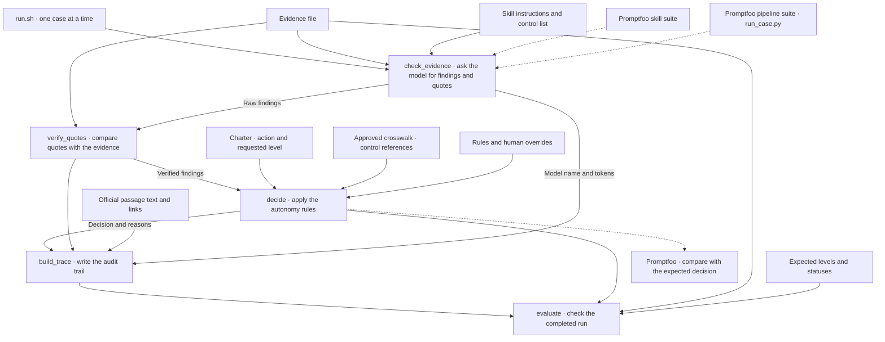

# Architecture

One run works through the cases in `tests/cases.csv`. Each case pairs an action from Maria’s charter with one evidence file. The chart shows where each input enters the process.

The model call happens in `call_model.py`. The quote verifier, decision engine, trace builder, and evaluator use ordinary code. The evaluator checks the saved decisions and independently matches kept quotes against the evidence. Promptfoo’s skill suite checks the raw model answer. Its pipeline suite calls the evidence checker, verifier, and decision engine through `run_case.py` and checks the returned decision.

## T4 example · Human oversight for valve closure

1. **Official passage.** AI Act Article 14(4)(e) describes the ability to intervene or interrupt a high-risk AI system so that it halts in a safe state. [Saved passage and official link in the T4 trace](reports/2026-11-17T17-59-25-0500/T4.md#c-ov-1)
2. **Crosswalk.** Approved link L3 maps that passage to C-OV-1. The vendor builds the stop function and the utility assigns the person who can use it. [Crosswalk](crosswalk/crosswalk.csv)
3. **Case evidence.** The verifier found this sentence in the operations procedure: “Maria, operations lead, or the duty engineer approves each valve closure proposed by LeakGuard and can override or stop LeakGuard at any time.” C-OV-1 was `met` and passed the requirement at both higher autonomy levels. [T4 evidence](evidence/E4_valves_complete.md)
4. **Decision.** T4 passed all eight controls. The charter records valve closure as irreversible with many customers affected, so rule `R-IRREVERSIBLE` blocked `act_alone`. The decision was `act_with_approval / decided`. [T4 decision trace](reports/2026-11-17T17-59-25-0500/T4.md)
